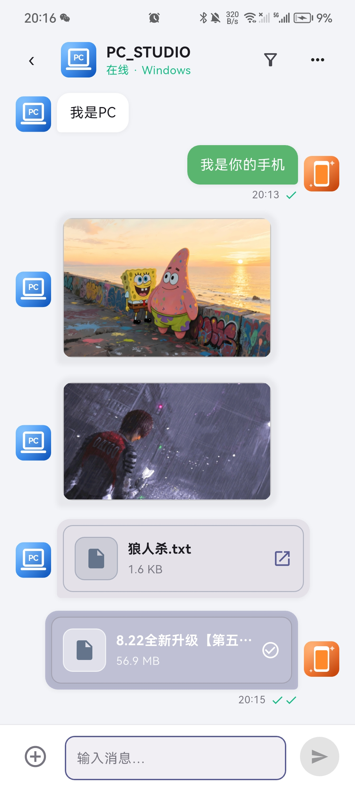
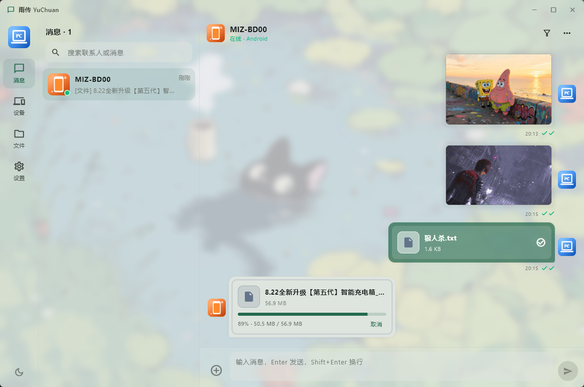
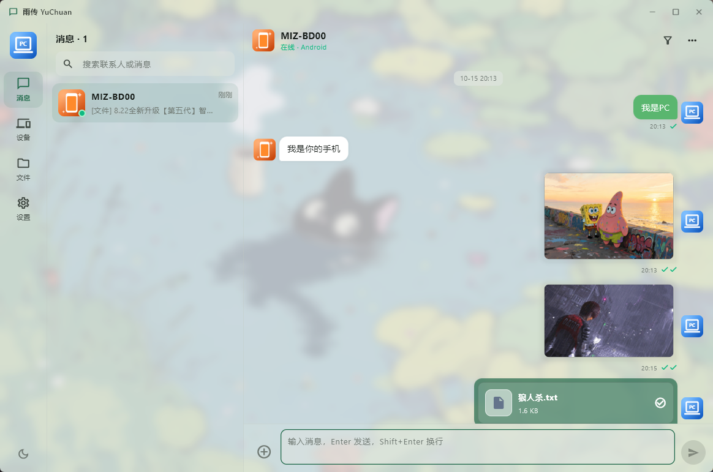

<div align="center">


# 雨传 YuChuan

**一个局域网聊天 / 传文件工具。轻松解决传文件和文字的繁琐操作，摆脱其他臃肿的软件、繁琐的操作和网络的限制。**

Android · Windows

</div>

---

## 这是什么

同一个局域网里，手机和电脑直接互相聊天、传文件。**不用账号、不用登录、不用联网、不经过任何服务器** —— 两台设备之间点对点直连，数据只走你自己的网络。

## 为什么用它

- **不经公网、不经第三方**：文件只在两台设备之间传输，不落到别人的服务器上
- **不用注册、不用加好友、不用扫码**：同一网络下自动发现，配对一次就记住
- **不用数据线、不用 U 盘**：手机 ↔ 电脑双向传
- **不压缩、不改格式、不限速**：原文件直传，大文件也不限大小
- **没有多余的东西**：打开就能聊、就能传

## 功能

### 发现与配对

- 打开即自动发现同一局域网内的设备，**无需手动输入 IP**
- 配对请求双端弹窗确认，配对成功后自动关闭发现（省电）
- 记住配对关系与备注名、头像，下次打开直接聊
- 设备列表区分「已配对 / 未配对」，在线状态实时显示

### 聊天

- 文字、图片、文件、文件夹，**收发的一切内容都按时间线显示在同一个会话里**
- 图片圆角预览，不裁剪
- 消息里的网址自动识别为链接，单击直接打开浏览器
- **双击文字气泡即复制**
- 气泡右键（PC）/ 长按（手机）菜单：复制、转发、多选、重新发送
- 消息提醒以 OSD 气泡呈现，不打断当前操作

### 传文件

- 单个 / 多个文件、**整个文件夹**（保留目录结构）
- 多种发送方式：
  - PC：拖拽文件到窗口、右键菜单
  - Android：系统分享 →「雨传」
  - 两端：粘贴发送、「粘贴并发送」
- 大文件显示实时进度，支持**暂停 / 继续 / 取消 / 重试**
- **断点续传**：中断后从已接收的位置继续，不用重头再来
- **离线发送**：对方不在线时自动排队，对方一上线自动补发
- 接收目录可自定义
- 传输结果记入历史，重启后仍能看到真实的进度与文件路径

### 文件 TAB（独立的文件浏览页）

- 图标视图 / 列表视图两种布局，可切换排序方式，可按类型筛选
- PC 端**左键拖拽框选**，Ctrl + 点击追加选择；点击空白处开始框选
- 双击用默认程序打开；没有默认程序时打开所在目录
- **「打开方式」调起系统程序列表**，可选「始终 / 仅一次」并记住选择
- 右键 / 长按菜单：打开、打开方式、打开所在目录、发送、重命名、删除、清空
- 删除、清空、发送都支持对**所有选中项**批量操作

### 连接与后台

- 安卓前台服务保活：**切到后台不断开**，回到前台继续收发
- 连接断开自动重连，重新连上后自动补齐双方离线期间产生的消息
- PC 资源管理器右键菜单**「通过雨传发送」**（文件、文件夹均可）

### 外观

- 主题色自定义，浅色 / 深色**独立记忆**各自的配置
- 壁纸：自定义图片、不透明度、模糊度可调
- 界面细节可调：输入栏行数、输入区域不透明度等

## 截图

**安卓端 · 聊天（文字、图片、文件混排）**



**PC 端 · 接收大文件（实时进度、可取消）**



**PC 端 · 聊天会话**



## 平台支持

| 平台 | 状态 |
|------|------|
| Android（arm64-v8a） | 支持 |
| Windows | 支持 |

## 文件结构

```
YuChuan/
├─ icon.png                     应用图标源图（1024×1024）
├─ lib/                         Flutter 侧（界面 + 状态）
│  ├─ main.dart                 入口：初始化、生命周期、OSD 桥接
│  ├─ app_state.dart            核心状态机：会话/消息/在线/传输/设置
│  ├─ appearance.dart           外观状态：主题色、壁纸、透明度
│  ├─ models.dart               数据模型：设备 / 会话 / 消息
│  ├─ ui/                       界面
│  │  ├─ chat_list.dart         消息列表页
│  │  ├─ chat_page.dart         会话页（气泡、输入栏、传输卡片）
│  │  ├─ files_page.dart        文件 TAB（网格/列表、框选、排序、筛选）
│  │  ├─ discovery.dart         设备发现与配对
│  │  ├─ settings_page.dart     设置（主题与壁纸/界面/通知/发现与连接/传输/关于）
│  │  ├─ menus.dart             统一菜单（桌面弹出 / 安卓底部弹层）
│  │  ├─ osd_toast.dart         OSD 提示胶囊
│  │  ├─ pairing_dialog.dart    配对确认窗
│  │  ├─ open_with_sheet.dart   「打开方式」选择
│  │  └─ …                      标题栏 / 链接识别 / 选色 / 设备图标 / 引导
│  ├─ services/                 对 Rust 的封装，隔离平台差异
│  │  ├─ chat_service.dart      聊天与消息
│  │  ├─ discovery_service.dart 设备发现
│  │  ├─ pairing_service.dart   配对
│  │  ├─ transfer_service.dart  文件传输
│  │  ├─ platform_channel.dart  系统能力（打开文件/打开方式/安装包/保活）
│  │  └─ single_instance.dart   PC 单实例
│  └─ src/rust/                 frb 生成的桥接代码（勿手改）
│
├─ rust_builder/                Rust 侧（网络与存储的实现）
│  └─ src/
│     ├─ api/                   导出给 Dart 的接口
│     │  ├─ chat.rs             会话 / 消息 / 发件箱
│     │  ├─ discovery.rs        发现与设备
│     │  ├─ pairing.rs          配对
│     │  └─ transfer.rs         传输控制
│     ├─ backend/               真正的实现
│     │  ├─ discovery.rs        组播发现
│     │  ├─ session.rs          TCP 会话：握手、心跳、退避重连
│     │  ├─ protocol.rs         帧格式
│     │  ├─ pairing.rs          配对状态机
│     │  ├─ storage.rs          聊天仓库 / 发件箱 / 联系人落盘
│     │  └─ transfer.rs         分块传输、流控、断点续传
│     └─ frb_generated.rs       frb 生成（勿手改）
│
├─ android/                     安卓壳
│  └─ app/src/main/kotlin/com/yuchuan/app/
│     ├─ MainActivity.kt        平台通道 + 系统分享入口
│     └─ TransferService.kt     前台服务（后台保活）
├─ windows/                     Windows 壳（标准 Flutter runner）
├─ test/                        测试
├─ scripts/                     构建与辅助脚本
├─ Screenshots/                 README 截图
└─ flutter_rust_bridge.yaml     桥接代码生成配置
```

**一句话分工**：Flutter 只管画界面和存状态，网络收发、断点续传、消息落盘全部由
Rust 实现，两边通过 `flutter_rust_bridge` 调用。

想深入了解各模块职责、关键流程与本地数据文件，见 **[ARCHITECTURE.md](ARCHITECTURE.md)**。
